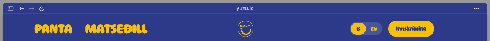
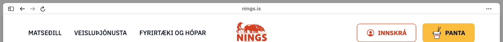

# Zen Tweaks

A slimmer, Arc-like top toolbar for [Zen](https://zen-browser.app) on macOS.




## What it changes

For the **Sidebar and Top Toolbar** layout (Settings > Look and Feel):

- **Slim toolbar:** the top toolbar is 70% of its normal height.
- **Address as plain text:** just the domain (`youtube.com`), centred in the window, with no box and no icons. Cmd+L or typing still opens Zen's search.
- **Page-coloured toolbar:** the toolbar sits inside the page card and takes the page's own top colour, with dark or light icons to match, like Arc. A hairline separates it from the page.
- **Traffic lights in the toolbar:** the window buttons sit at the toolbar's left, with back, forward and reload on the right next to the ⋯ menu. The search placeholder is hidden.
- **Loading indicator:** a small pill in the middle of the toolbar takes the domain's place while a page loads, then the domain returns.
- **Fullscreen:** the domain hides when a page goes fullscreen (for example video).
- **Compact mode:** the floating sidebar runs the full height of the window, slightly see-through (90%), with the sidebar toggle in its top-left above the essentials.
- **Empty tabs:** with no page open, the toolbar takes the same grey as Zen's empty page.
- **Loading:** a search that opens a new tab keeps that grey until the page loads, instead of flashing white.
- **Traffic lights:** Zen's resting dots take their colour from the page, so they stay visible on light and dark pages.


## Install

1. Quit Zen (Cmd+Q).
2. Clone this repo and run the installer:

   ```bash
   git clone https://github.com/stackoverprof/zen-tweaks.git
   cd zen-tweaks
   ./install.sh
   ```

3. Open Zen. The mod shows under Settings > Zen Mods as "Zen Tweaks".

macOS may ask once to let Terminal control Finder: the startup script has to go inside `Zen.app`, and macOS only lets Finder write there.

**Mod only:** `./install.sh --mod-only` installs just the CSS. You still get the slim toolbar, but not the domain-only address, page colours or the moved traffic lights, which need the startup script.

**Another profile:** `ZEN_PROFILE=/path/to/profile ./install.sh`.

## After a Zen update

Updates replace `Zen.app`, which removes the startup script. Run `./install.sh` again (the mod in your profile is kept).

## Uninstall

```bash
./install.sh --remove
```

## How it works

- `mod/chrome.css` is a regular Zen mod (CSS), registered in your profile like a store mod.
- `startup-script/` is a Firefox [AutoConfig](https://support.mozilla.org/kb/customizing-firefox-using-autoconfig) script that runs inside Zen at startup. It shortens the address to the domain through Zen's own URL-trimming hook, samples the top row of the page for the toolbar colour, and moves the traffic lights to the toolbar's left. It doesn't send anything anywhere.

Tested on Zen 1.24.1b (Firefox 159) on macOS 26.

## License

MIT
